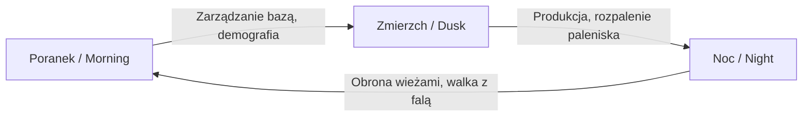
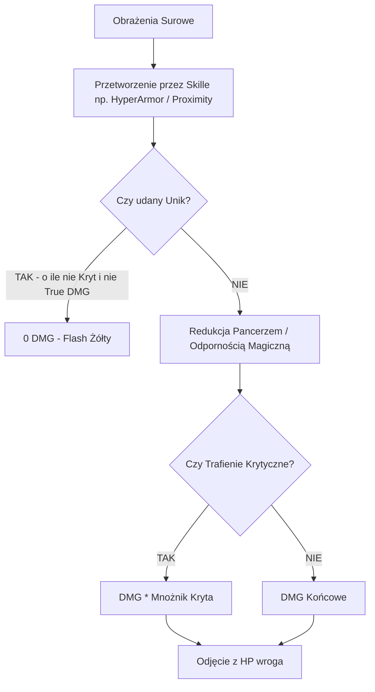
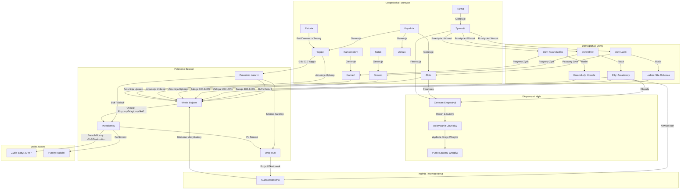

# Dwarfen Tower Defence – Oficjalny Dokument Balansu Gry (Balance Design Document)

Niniejszy dokument stanowi wyczerpujące, techniczne kompendium parametrów, wzorów matematycznych, mechanik oraz zależności systemowych gry **DwarfenTowerDefence**. Został przygotowany jako pojedynczy, kompletny plik referencyjny na potrzeby analizy, modelowania matematycznego i rebalansowania rozgrywki we współpracy z modelem sztucznej inteligencji.

Dokument opisuje w 100% stan faktyczny implementacji **Core Loop** (rzeczywistej rozgrywki w ramach sesji), pobierając surowe dane z kodu C# oraz assetów `ScriptableObject`.

---

## SPIS TREŚCI
1. [Architektura Pętli Gry (Core Game Loop & Phase Timing)](#1-architektura-pętli-gry-core-game-loop--phase-timing)
2. [Ekonomia, Surowce i Budynki Produkcyjne](#2-ekonomia-surowce-i-budynki-produkcyjne)
3. [Demografia, Rasy i Domy Mieszkalne](#3-demografia-rasy-i-domy-mieszkalne)
4. [Topologia Mapy, Siatka Heksagonalna i Ekspansja](#4-topologia-mapy-siatka-heksagonalna-i-ekspansja)
5. [Wieże Bojowe (Tower Defense) – Parametry i Matematyka](#5-wieże-bojowe-tower-defense--parametry-i-matematyka)
6. [Przeciwnicy, Umiejętności i Mechanika Spawnera](#6-przeciwnicy-umiejętności-i-mechanika-spawnera)
7. [Palenisko Latarni (The Beacon Hearth System)](#7-palenisko-latarni-the-beacon-hearth-system)
8. [System Run, Kuźnia Runiczna i Modyfikatory](#8-system-run-kuźnia-runiczna-i-modyfikatory)
9. [Wyliczone Metryki Balansu i Audyt Anomalii](#9-wyliczone-metryki-balansu-i-audyt-anomalii)
10. [Matryca Zależności Systemowych (Mermaid Dependency Graph)](#10-matryca-zależności-systemowych-mermaid-dependency-graph)

---

## 1. Architektura Pętli Gry (Core Game Loop & Phase Timing)

Rozgrywka podzielona jest na dobowy cykl 3 faz zarządzany przez `TimePhaseManager`, z synchronizacją ekonomiczną i bojową w `BuildingRegistry`, `ResourceManager`, `HousingEntity` oraz `EnemySpawner`.



### 1.1. Faza 1: Poranek (Morning)
1. **Rozliczenie Demografii i Gospodarki Domowej (`BuildingRegistry.ExecuteMorningHousingEconomy`)**:
   - `ProcessMorningProduction()`: Każdy dom generuje pasywny przychód surowców mnożony przez liczbę mieszkańców (np. ludzie generują złoto, elfy drewno, krasnoludy kamień).
   - `ProcessMorningSurvival()`: Pobranie kosztów przeżycia (żywność i surowce bazowe). Jeśli osada nie ma zasobów na przeżycie $\to$ stan **GŁÓD**, postęp wzrostu populacji cofa się o 1 punkt.
   - `ProcessMorningGrowth()`: Jeśli przeżycie zostało opłacone, a gracz nie wstrzymał wzrostu (`stopGrowth == false`), gra sprawdza i pobiera nadwyżkę surowców (`growthSurplusCost`). Jeśli stać osadę $\to$ postęp rośnie o 1 tick. Po osiągnięciu progu rodzi się nowy obywatel.
2. **Reset Dzienny Pracowników (`HandleDayReset`)**:
   - Zdjęcie nocnej blokady pracowników (`Workers.ResetWorkersForNewDay()`).
   - Aktualizacja modyfikatorów terenowych.
3. **Czas Wolny Gracza**:
   - Budowanie nowych struktur, wytyczanie dróg, zlecanie zwiadu/ekspedycji, przydzielanie pracowników do tartaków, kamieniołomów, kopalń, farm i kuźni.

### 1.2. Faza 2: Zmierzch (Dusk)
1. **Rozliczenie Produkcji Gospodarczej (`BuildingRegistry.ExecuteDuskEconomy`)**:
   - `ProcessUpkeep()`: Sprawdzenie i pobranie kosztu utrzymania budynków produkcyjnych (drewno, złoto itp.).
     - Jeśli surowce są $\to$ budynek pracuje z pełną wydajnością.
     - Jeśli brak surowców $\to$ kara `-0.5` do mnożnika wydajności (minimum 0.1).
   - `ProcessProduction()`: Budynki generują urobek do `ResourceManager` z uwzględnieniem bazy, terenu, ulepszeń, mnożnika załogi oraz bonusu z Paleniska z poprzedniej nocy.
2. **Postęp Ekspedycji**:
   - Misje zwiadowcze i kolonizacyjne przesuwają licznik dni do odsłonięcia kolejnych chunków.
3. **Przygotowanie do Nocy**:
   - Ustalenie poziomu rozpalenia Latarni Nadziei (`Beacon of Hope`) poprzez spalenie węgla w Palenisku (decyzja o bonusach/karach na noc i kolejny dzień).
   - Przypisanie załóg do wież bojowych (załoga podnosi skuteczność wieży od 20% do 140%).

### 1.3. Faza 3: Noc (Night)
1. **Rozliczenie Utrzymania Obrony (`BuildingRegistry.ExecuteNightDefenseUpkeep`)**:
   - Każda wieża obronna (`BuildingType.Defense`) próbuje pobrać swój dobowy `upkeepPerCycle` (np. drewno/kamień/węgiel/złoto jako amunicję).
   - **Brak amunicji**: wieża otrzymuje stałą karę `-0.5` do swojej efektywności załogi na całą noc (zadaje o 50% mniej obrażeń i strzela o 50% wolniej).
2. **Blokada Załóg**:
   - Przypisani do wież pracownicy zostają zablokowani na czas nocy (`Workers.LockWorkers()`). Gracz nie może wycofać obsługi w trakcie walki.
3. **Inicjalizacja Spawnera (`EnemySpawner.HandleNightPhase`)**:
   - Z kolejki fali (`WaveDefinition`) jednostki wypuszczane są w zadanym interwale (`nightSpawnInterval`).
   - Punkt spawnu jest dynamiczny: to **pierwszy odsłonięty heks na trasie wroga na granicy mgły wojny**.
4. **Warunki Porażki / Zwycięstwa**:
   - **HP Bazy (`mainGateHP`)**: Startowo równe **20 HP** (definiowane w `CityBaseConfigSO`).
   - Każdy wróg rangi **Normal**, który dotrze do serca bazy: `-1 HP`.
   - Każdy wróg rangi **Elite**, który dotrze do serca bazy: `-3 HP`.
   - Każdy wróg rangi **Boss**, który dotrze do serca bazy: natychmiastowe **InstantDestruction (Koniec Gry)**.
   - Gdy `mainGateHP <= 0` $\to$ wywołanie `OnGameOver`.
   - Po zabiciu wszystkich wrogów z kolejki i oczyszczeniu mapy $\to$ automatyczne przejście do fazy Poranka kolejnego dnia.

---

## 2. Ekonomia, Surowce i Budynki Produkcyjne

### 2.1. Zasoby w Grze (`ResourceType`)
W grze istnieje 8 zasobów:
1. **Złoto (Gold)**: Waluta rekrutacji, budowy zaawansowanych struktur i ekspedycji.
2. **Drewno (Wood)**: Podstawowy materiał konstrukcyjny i opał do retort.
3. **Kamień (Stone)**: Materiał na mury, fundamenty wież i zaawansowane budynki.
4. **Węgiel (Coal)**: Kluczowe paliwo do wież parowych oraz do rozpalania Paleniska Latarni Nadziei.
5. **Żywność (Food)**: Podstawa przetrwania mieszkańców osady i ekspedycji zwiadowczych.
6. **Populacja (Population)**: Dostępna siła robocza (zarządzana per rasa).
7. **Żelazo (Iron)**: Rzadki surowiec metalurgiczny do kuźni runicznych i wież wyższego rzędu.
8. **Nadzieja (Hope)**: Punkty osiągnięć w sesji generowane przez zabijanie wrogów i rozwój.

#### Surowce Startowe Bazy (`CityBaseConfig.asset`):
- **Złoto**: $40$
- **Drewno**: $20$
- **Kamień**: $15$
- **Żelazo**: $0$
- **Węgiel**: $0$
- **Żywność**: $60$
- **HP Bazy**: $20$

---

### 2.2. Tabela Budynków Ekonomicznych i Infrastruktury

| Budynek | Typ | Koszt Budowy | Koszt Utrzymania (Upkeep / Cykl) | Baza Produkcji / Cykl | Dozwolony Teren | Załoga (Baza) | Specjalne Wymagania |
| :--- | :--- | :--- | :--- | :--- | :--- | :--- | :--- |
| **Tartak (Sawmill)** | Economic | 15 Złota, 5 Kamienia | 5 Złota | 10 Drewna | Las | 1 | Bonus za sąsiadujące lasy |
| **Kamieniołom (Quarry)** | Economic | 5 Złota, 10 Drewna | 4 Złota, 1 Drewno | 10 Kamienia | Wzgórze, Trawa | 1 | Brak |
| **Kopalnia (Mine)** | Economic | 15 Złota, 40 Drewna, 40 Kamienia | 10 Drewna, 10 Kamienia | 6 Złota, 2 Węgla, 2 Żelaza | Góry | 1 | Wymaga heksa Góry |
| **Retorta (Retort)** | Economic | 10 Złota, 50 Drewna, 30 Kamienia | 20 Drewna | 7 Węgla | Trawa, Las, Góra | 1 | Przetwarza drewno na węgiel |
| **Farma (Farm)** | Economic | 5 Złota, 5 Drewna, 5 Kamienia | 6 Drewna | 30 Żywności | Trawa, Żyzna Gleba | 1 | Bonus za Żyzną Glebę |
| **Centrum Ekspedycji** | Utility | 5 Drewna | 0 | 0 | Dowolny | 1 | Wymaga pracownika: **Elf** |
| **Kuźnia Runiczna (RuneSmith)**| Utility | 100G, 80W, 50S, 40 Iron | 0 | 0 | Dowolny | 1 | Wymaga: **Krasnolud**; nasyca wieże |
| **Wieża Runiczna** | Utility | 200 Złota | 0 | 0 | Dowolny | 0 | Budowana obok Kuźni (+1 slot) |
| **Posterunek (Outpost)** | Utility | 5 Drewna | 0 | 0 | Dowolny | 1 | Rozszerza strefę militarną |
| **Latarnia Nadziei (Beacon)** | Unique | Niewykonalny (Startowy) | Palenisko (0–110 Węgla) | Modyfikatory Nocy/Dnia | Centrum (0,0) | 1 | Serce obrony kotliny |

---

### 2.3. Wzory Matematyczne Produkcji Budynków

Produkcja obliczana jest w `BuildingProductionComponent` według wzoru:
$$\text{Produkcja Końcowa} = \left( \text{Produkcja Bazowa} + \text{Bonus Terenowy} + \text{Bonusy Ulepszeń} \right) \times \text{Mnożnik Globalny} \times \text{Efektywność Załogi}$$

#### 1. Mnożnik Załogi (`efficiencyTable`):
Dla budynków ekonomicznych obowiązuje krzywa:
- **0 pracowników**: $0.0$ (brak produkcji)
- **1 pracownik**: $1.0$ ($100\%$ bazowej wydajności)
- **2 pracowników**: $1.25$ ($+25\%$)
- **3 pracowników**: $1.50$ ($+50\%$)
- **4 pracowników**: $1.75$ ($+75\%$)
- **5 pracowników**: $2.00$ ($+100\%$)
- **6 pracowników**: $2.15$ ($+115\%$)
*(Gdy brak wpisu w tabeli: $\text{Eff} = 1.0 + (\text{liczba} - 1) \times 0.25$)*.

#### 2. Kara za Brak Utrzymania (Upkeep Penalty):
Jeżeli osada nie posiada wymaganych surowców na utrzymanie budynku w fazie Dusk:
$$\text{Efektywność Załogi}_{\text{final}} = \max\left(0.1, \text{Efektywność Załogi} - 0.5\right)$$
*Nawet w przypadku braku surowców budynek zachowuje minimum 10% wydajności.*

#### 3. Bonus Terenowy (`TerrainBonusRule`):
- **Tartak**: Reguła na Las (`Forest`, promień 0):
  $$\text{Bonus Drewna} = \max\left(1.0, \text{baseBonusPerHex} \times \text{liczba lasów}\right) + \text{onTopProductionBonus}$$
  W assetcie `Sawmill.asset`: `baseBonusPerHex = 3`, `minBonus = 1`, `onTopProductionBonus = 5`.
- **Farma**: Reguła na Żyzną Glebę (`FertileSoil`, promień 0):
  $$\text{Bonus Żywności} = \max\left(0, (5 - 2 \times \text{użytkownicy}) \times \text{liczba heksów}\right) + 10$$
  W assetcie `Farm.asset`: `baseBonusPerHex = 5`, `penaltyPerUser = 2`, `onTopProductionBonus = 10`.

#### 4. Mnożnik Globalny (`GetGlobalMultiplier`):
$$\text{Mnożnik Globalny} = \max\left(0.1, 1.0 + \text{Bonus Paleniska} + \text{Bonus Ulepszeń}\right)$$
*Gdzie Bonus Paleniska waha się od $-25\%$ (Wygasły Popiół) do $+35\%$ (Palenisko Magmy).*

#### 5. Bufor Części Ułamkowych (`AddToBufferAndGetWhole`):
Gra nie gubi ułamków produkcji. Części ułamkowe trafiają do bufora `productionBuffer`. W cyklu, w którym bufor przekroczy $\ge 1.0$, do magazynu dodawany jest dodatkowy cały zasób.

---

## 3. Demografia, Rasy i Domy Mieszkalne

W grze występują trzy rasy o odmiennych specjalizacjach ekonomiczno-taktycznych.

```
       ┌───────────────┐
       │   POPULACJA   │
       └───┬───┬───┬───┘
           │   │   │
   ┌───────┘   │   └───────┐
   ▼           ▼           ▼
[LUDZIE]    [ELFY]    [KRASNOLUDY]
• Złoto     • Drewno  • Kamień
• Uniwersal • Zwiad   • Kuźnia Run
```

### 3.1. Rasy i ich Role
1. **Ludzie (Humans)**:
   - Podstawowa siła robocza.
   - Ich obecność w domach generuje **Złoto**.
   - Idealni do prac polowych i standardowych manufaktur.
2. **Elfy (Elves)**:
   - Mistrzowie natury i zwiadu.
   - Ich domy generują **Drewno**.
   - **Kluczowa rola**: Są jedyną rasą zdolną obsadzić **Centrum Ekspedycji** (`Expedition Center`) i wyruszać na zwiad (`Recon`) oraz kolonizację (`Survey`) mgły.
3. **Krasnoludy (Dwarves)**:
   - Mistrzowie gór i rzemiosła.
   - Ich domy generują **Kamień**.
   - **Kluczowa rola**: Są jedyną rasą zdolną obsadzić **Kuźnię Runiczną** (`RuneSmith`) jako kowale runiczni aktywujący sloty wzmocnień wież.

---

### 3.2. Szczegółowe Parametry Domów Mieszkalnych

| Parametr | Dom Ludzki (`Human house`) | Dom Elficki (`Elf house`) | Dom Krasnoludzki (`Dwarven house`) |
| :--- | :--- | :--- | :--- |
| **Rasa mieszkańców** | Ludzie (Race 0) | Elfy (Race 1) | Krasnoludy (Race 2) |
| **Koszt budowy** | 5 Złota, 10 Drewna, 20 Żywności | 10 Żywności, 25 Drewna | 5 Drewna, 20 Kamienia, 20 Żywności |
| **Upkeep stały budynku** | 1 Drewno | 1 Drewno | 1 Drewno |
| **Startowi mieszkańcy (Config)** | **1** (Config nadpisuje z 2) | **0** (Config nadpisuje z 1) | **0** (Config nadpisuje z 1) |
| **Maksymalna pojemność (Config)**| **4** (Config nadpisuje z 5) | **3** (Config nadpisuje z 4) | **3** (Config nadpisuje z 4) |
| **Pasywna produkcja / mieszkańca**| **+2 Złota** / mieszkańca | **+1 Drewna** / mieszkańca | **+1 Kamienia** / mieszkańca |
| **Dobowy koszt przeżycia (Baza)** | 10 Żywności, 2 Drewna, 2 Kamienia | 6 Żywności, 5 Drewna | 5 Żywności, 4 Kamienia |
| **Dobowy koszt przeżycia (Per Pop)**| **+4 Żywności** / mieszkańca | **+2 Żywności** / mieszkańca | **+6 Żywności, +1 Kamienia** / pop |
| **Koszt nadwyżki wzrostu (Surplus)**| **5 Żywności** | **8 Żywności** | **8 Żywności** |
| **Wymagane ticki do narodzin** | $1 + \text{Pop} \times 2$ | $2 + \text{Pop} \times 2$ | $3 + \text{Pop} \times 2$ |

---

### 3.3. Matematyka Wzrostu Populacji i Głodu
Każdego ranka w `HousingEntity` realizowany jest algorytm:

1. **Wymagane Ticki Wzrostu**:
   $$\text{Wymagane Dni} = \text{baseGrowthTicks} + \text{Aktualna Liczba Mieszkańców} \times \text{growthDifficultyMultiplier}$$
   - *Dla Ludzi*: $1 + 1 \times 2 = 3$ dni (przy 1 mieszkańcu); $1 + 2 \times 2 = 5$ dni (przy 2 mieszkańcach).
   - *Dla Elfów*: $2 + 1 \times 2 = 4$ dni (przy 1 mieszkańcu).
   - *Dla Krasnoludów*: $3 + 1 \times 2 = 5$ dni (przy 1 mieszkańcu).

2. **Kolejność Pobierania Zasobów**:
   - Najpierw sprawdzany jest `CalculateSurvivalCost()`. Jeśli brak choćby 1 surowca:
     - `currentGrowthProgress` spada o 1 (postęp demograficzny cofa się).
     - Status domu: `GŁÓD (-1 CYKL)`.
   - Jeśli przeżycie opłacono i `stopGrowth == false`:
     - Sprawdzany jest `CalculateGrowthCost()`. Jeśli brakuje surowców nadwyżki:
       - Status: `BRAK NADWYŻKI` (postęp stoi w miejscu).
     - Jeśli osadę stać na nadwyżkę:
       - `currentGrowthProgress++`.
       - Gdy `currentGrowthProgress >= Wymagane Dni` $\to$ rodzi się nowy obywatel danej rasy, a licznik zeruje się.

---

## 4. Topologia Mapy, Siatka Heksagonalna, Generacja Terenu i Ekspansja

### 4.1. Słowniczek Terminów Topologii Dróg
- **Spawner**: Chunk krańcowy ścieżki (głównej lub bocznej), na którym rodzą się wrogowie po całkowitym odkryciu prowadzącej do niego trasy, albo graniczny chunk mgły wojny (`Hidden`), z którego wrogowie wychodzą na pierwszy odsłonięty chunk (`Outskirts` / `Settled`).
- **Rozdroże (Crossroads)**: Chunk na ścieżce posiadający więcej niż jedno wejście lub wyjście (`isCrossroads == true`). Tworzy czysty kształt litery **Y** lub **T** wokół centralnego węzła (`hubHex`, w odległości $\le 1$ od środka chunka), bez zbędnych zawijasów.
  - **Rozdroże 1 (Merge / Zbiorcze)**: Rozdroże bliżej bazy, w którym pętla lub odnoga boczna łączy się z powrotem z główną arterią.
  - **Rozdroże 2 (Split / Rozdzielające)**: Rozdroże dalej od bazy (w głąb mgły), w którym ścieżka rozwidla się na dwa warianty (główny i pętlowy).
- **Pętla (Loop)**: Alternatywna ścieżka boczna (`LoopDefinition`), która odchodzi od głównej trasy na `Rozdrożu 2` i wraca do niej na `Rozdrożu 1` bliżej bazy. Nie tworzy własnego spawnera końcowego, lecz dzieli ruch wrogów po odkryciu `Rozdroża 2`.
- **Ścieżka / Odnoga Boczna (Side Branch)**: Trasa odchodząca od głównej ścieżki w kierunku od bazy na zewnątrz mapy ($\text{dist}(\text{next}, 0) \ge \text{dist}(\text{curr}, 0)$), zakończona własnym, dedykowanym spawnerem.

---

### 4.2. Matematyka Siatki Heksagonalnej (`HexGridMath`)
- Układ współrzędnych: Osiowy (`Axial Coordinates` $q, r$).
- Promień chunka: `chunkRadius = 3` (w generatorze mapy) / `4` (w układzie bazy). Standardowy chunk proceduralny o promieniu `3` składa się z **37 heksów** ($1 + 3 \times 3 \times (3 + 1) = 37$).
- Rozmiar heksa w silniku: `hexSize = 1f`, `padding = 0.02f`.
- **Konwersja Axial $\to$ World (3D)**:
  $$X = (\text{hexSize} + \text{padding}) \times \sqrt{3} \times \left(q + \frac{r}{2}\right)$$
  $$Z = (\text{hexSize} + \text{padding}) \times \frac{3}{2} \times r$$
- **Środek chunka na mapie świata (`chunkRadius = 3`)**:
  $$\text{centerQ} = c_q \times (2 \times \text{radius} + 1) + c_r \times \text{radius} = 7 c_q + 3 c_r$$
  $$\text{centerR} = c_q \times (-\text{radius}) + c_r \times (\text{radius} + 1) = -3 c_q + 4 c_r$$

---

### 4.3. Deterministyczny Generator (`MapRng`) i Pierścieniowa Generacja Zasobów (`TerrainGenerationConfig`)
System biomów został całkowicie usunięty na rzecz czytelnej, deterministycznej generacji opartej o `MapRng` (instancję `System.Random` inicjalizowaną przez `seed` w `HexMapGenerator`) oraz pierścienie odległości od bazy (`dist = HexDistance((0,0), chunkCoord)`):

| Pierścień (Odległość od Bazy) | Las (`Forest`) | Żyzna Gleba (`FertileSoil`) | Wzgórza (`Hill`, wys. 1–2) | Góry (`Mountain`, wys. 3) | Rola Taktyczna i Ekonomiczna |
| :-: | :-: | :-: | :-: | :-: | :--- |
| **Ring 1–2** *(Wczesna gra)* | **22%** | **14%** | **12%** | **0%** *(Zakaz)* | Szybki start gospodarki drzewnej, żywnościowej i kamienia; gwarantowany brak gór blokujących widoczność. |
| **Ring 3–4** *(Środkowa gra)* | **18%** | **10%** | **16%** | **10%** | Pierwszy dostęp do gór (`Mountain` / wysokość 3) pod kopalnie rudy i węgla oraz zaawansowane pozycje obronne. |
| **Ring 5+** *(Późna gra)* | **14%** | **8%** | **18%** | **16%** | Surowy krajobraz wysokogórski bogaty w minerały i naturalne wąwozy obronne. |

#### Twarde Gwarancje Surowcowe (`TerrainGenerator.EnsureGuarantees`):
Po wstępnym wylosowaniu terenu w każdym chunku (z zachowaniem bufora wokół drogi `roadBufferChanceReduction = 0.5`), walidator wymusza spełnienie minimalnych i maksymalnych progów:
1. **Pierścienie 1–2**:
   - Minimum **10 heksów Lasu (`Forest`)**.
   - Minimum **6 heksów Żyznej Gleby (`FertileSoil`)**.
   - Minimum **6 heksów Wzgórz (`Hill`)**.
   - Dokładnie **0 heksów Gór (`Mountain`)** (nadmiar jest automatycznie degradowany do `Plain`).
2. **Pierścienie 3–4**:
   - Minimum **10 heksów Gór (`Mountain`, wysokość 3)** rozłożonych na co najmniej **2 różnych chunkach** (`minChunksWithResource = 2`).

#### Chunki Unikatowe (`SpecialChunkPlacer`):
- Rozmieszczane deterministycznie w pierścieniach **3–8** (`minRingDistance = 3`, `maxRingDistance = 8`).
- **Całkowite wykluczenie ze ścieżek**: Chunk unikatowy nigdy nie może pojawić się na ścieżce głównej, pętli, odnodze bocznej, rozdrożu ani w bezpośrednim sąsiedztwie spawnerów ($\text{dist} > 1$).
- Respektuje predefiniowany układ heksów `layoutOverride` (jeśli przypisano `ChunkLayoutSO`).

---

### 4.4. Algorytm Generowania Ścieżek, Rozdroży i Pętli (`PathGenerator`)
1. **Główna Arteria (Path A)**:
   - Zaczyna się na chunku startowym `(0,0)` i biegnie aż do krawędzi mapy.
   - Gwarantowana minimalna długość: **$\ge 11$ chunków** (`minMainPathLength = 11`).
2. **Strefa Ochronna Startu (`safeStartChunks = 2`)**:
   - Pierwsze **2 chunki ścieżki najbliższe bazie** (indeksy `1` i `2` na Path A) mają absolutny zakaz posiadania rozdroży, pętli oraz odnóg bocznych (`!isCrossroads`).
   - Na każdym z tych dwóch pierwszych chunków wewnętrzna droga heksagonalna musi liczyć **minimum 6 heksów** (`internalPath.Count >= 6`), co wymusza lekki łuk/zakręt wewnątrz chunka i daje wieżom odpowiedni czas ostrzału już od pierwszej nocy.
3. **Pętle (`GenerateLoops`)**:
   - Domyślnie generowana jest **1 gwarantowana pętla** (`guaranteedLoops = 1`) oraz **30% szansy na drugą pętlę** (`secondLoopChance = 0.30f`).
   - Pętla odchodzi na `Rozdrożu 2` (dalej od bazy) i wraca na `Rozdrożu 1` (bliżej bazy, z zachowaniem strefy ochronnej $\ge 3$).
   - Pętla jest całkowicie rozłączna z omijanym odcinkiem głównej ścieżki i ma długość $\ge$ omijany segment.
4. **Odnogi Boczne (`GenerateSideBranches`)**:
   - Domyślnie **2 odnogi boczne** (`sideBranchesCount = 2`, długość `2–4` chunków).
   - Każda odnoga spełnia warunek monotonicznego oddalania się od bazy ($\text{dist}(\text{next}, 0) \ge \text{dist}(\text{curr}, 0)$) i kończy się własnym spawnerem.

---

### 4.5. Struktura Chunku Startowego (0,0) (`Chunk 0_0/Main_layout.asset`)
W sercu kotliny na starcie gry znajdują się predefiniowane obiekty:
- `(0, 0)`: **Latarnia Nadziei (Beacon of Hope)** [Feature 7].
- `(0, 1)`: **Kapitol / Główna Baza** [Feature 6].
- `(-3, 0)`: Predefiniowany **Dom Ludzki (Human House)** z 1 mieszkańcem.
- `(4, -2)`: **Punkt Bramy (Road Connection Edge)** – miejsce, w którym droga wrogów wchodzi do bazy.
- **Zasoby naturalne chunku startowego**:
  - Lasy (`Forest`): heksy `(-3, 3)`, `(-4, 2)`, `(-2, 1)`, `(-2, 4)`, `(-4, 4)`.
  - Żyzna gleba (`FertileSoil`): heksy `(2, -3)`, `(2, -2)`, `(0, -2)`.
  - Wzgórza/Góry (`Hill` poziom 1-3): heksy `(0, 4)`, `(1, 3)`, `(0, 3)`, `(-1, 4)`.

---

### 4.6. Mechanika Mgły Wojny i Ekspansji (`ExpansionCostConfig` & `MapExpansionManager`)

Gracz może odkrywać zamglone chunki wokół bazy za pośrednictwem **Centrum Ekspedycji**.

```
[Chunki Bazy / Odkryte] ──(Zwiad / Recon)──> Raport o Zasobach + Flaga Rozdroża (isCrossroads)
                        ──(Wyprawa / Survey)─> Odsłonięcie Chunku & Oddalenie Spawnu Wrogów
```

#### 1. Krótki Zwiad (Recon):
- **Wymóg**: 1 Elf.
- **Czas trwania**: 1 dzień (`reconDays = 1`).
- **Koszt**: 15 Złota, 10 Żywności.
- **Efekt**: Raport o obfitości zasobów na zamglonym chunku (*None*: 0, *Scarce*: 1–2, *Moderate*: 3–5, *Abundant*: 6+ heksów) oraz informacja taktyczna `isCrossroads`, ostrzegająca gracza, czy na badanym chunku znajduje się rozwidlenie dróg.

#### 2. Pełna Kolonizacja / Odkrycie (Survey):
- **Wymóg minimalny**: 2 Elfy (`minElvesForSurvey = 2`).
- **Odblokowanie wzdłuż dróg i pętli (`roadPredecessors`)**: Chunk drogowy (np. `Rozdroże 2` na końcu pętli) staje się dostępny do odkrycia wzdłuż traktu, gdy **którykolwiek** z jego poprzedników od strony bazy (`roadPredecessors`) ma status `Outskirts` lub `Settled`.
- **Formuła Dystansu**: Najkrótsza odległość heksagonalna $D$ od granicy aktualnie osiedlonych chunków.
- **Formuła Czasu (w dniach)**:
  $$\text{Współczynnik Czasu} = \text{clamp01}\left(\frac{D - 1}{\max(1, \text{maxDistanceForTime} - 1)}\right) \quad (\text{dla } \text{maxDistance} = 6)$$
  $$\text{Dni Bazowe} = \text{round}\left(\text{lerp}(1, 7, \text{Współczynnik Czasu})\right)$$
  - *Bonus za dodatkowe elfy*: Każdy dodatkowy Elf powyżej 2 skraca czas o **1 dzień** (`daysReductionPerExtraElf = 1`, minimum 1 dzień).
  - *Mnożnik drogi*: Jeśli przez chunk przechodzi trakt wroga: $\text{Dni} = \max(1, \text{round}(\text{Dni} \times 0.7))$.
- **Formuła Kosztów Złota i Żywności**:
  $$\text{Złoto}_{\text{baza}} = 30 + 15 \times (D - 1)$$
  $$\text{Żywność}_{\text{baza}} = 10 + 5 \times (D - 1)$$
  - *Mnożnik drogi*: Jeśli chunk leży na drodze, koszt wynosi $60\%$ ($\times 0.6$).
  - *Mnożnik załogi*: Jeśli wysłano więcej elfów, koszty rosną proporcjonalnie: $\times \frac{\text{Liczba Elfów}}{2}$.

#### 3. Kluczowa Zależność Taktyczna Ekspansji (Skanowanie Wsteczne od Bazy):
Wrogowie poruszają się wyłącznie po **ciągłym łańcuchu odkrytych chunków prowadzących od Bazy `(0,0)`**:
- `EnemySpawner` skanuje każdą trasę wstecz od Bazy `(0,0)` aż do pierwszego zamglonego chunka (`Hidden`), który staje się aktualnym punktem wejścia wrogów z mgły.
- Odkrycie „wyspy” w głębi mapy (bez ciągłego połączenia drogowego z bazą) **nie przesuwa** punktu spawnu.
- Dopóki gracz nie odkryje chunka z `Rozdrożem`, wszystkie trasy przechodzące przez to rozdroże są **skonsolidowane** w jedną aktywną ścieżkę o pełnej wadze. Dopiero odsłonięcie rozdroża aktywuje podział ruchu na odnogę lub pętlę.

---

## 5. Wieże Bojowe (Tower Defense) – Parametry i Matematyka

W grze zaimplementowano 7 zróżnicowanych machin obronnych. Każda wieża dziedziczy po `BuildingData` i jest kontrolowana przez `TowerController` oraz `TowerEntity`.

### 5.1. Kompletna Tabela Statystyk Bojowych Wież

| # | Nazwa Wieży | Koszt Budowy | Koszt Utrzymania (Upkeep/Noc) | Zasięg (Range) | Obrażenia (DMG) | Szybkostrzelność (FireRate) | Surowy DPS | Szansa na Kryt | Mnożnik Kryta | AP | MP | Typ DMG | Typ Pocisku |
| :- | :--- | :--- | :--- | :-: | :-: | :-: | :-: | :-: | :-: | :-: | :-: | :--- | :--- |
| **1** | **Sentinel Arbalest (Arbalet)** | 10G, 5W | 2 Złota | 15.0 | 25.0 | 3.0 /s | **75.0** | 10% | 2.5x | 0% | 0% | Fizyczny | Simple / Linear |
| **2** | **Thunderbuss (Garłacz Gromowy)**| 5G, 5W | **0** | 5.0 | 20.0 | 3.0 /s | **60.0** | 10% | 2.0x | 0% | 0% | Fizyczny | Simple / Spread |
| **3** | **Steam Repeater (Repetier)** | 5C, 3W | 1 Stone, 1 Coal | 14.0 | 10.0 | 8.0 /s | **80.0** | 10% | 1.5x | 0% | 0% | Fizyczny | Szybki Linear |
| **4** | **Crucible of Cinders (Tygiel)** | 10G, 5S, 5C | 2 Wood, 2 Stone | 5.0 | 10.0 | 0.5 /s | **5.0** | 2% | 1.5x | 0% | 0% | Magiczny | Ground AoE (Ogień) |
| **5** | **Shadow Spire (Iglica Cieni)** | 35W, 10S | 7 Drewna | 25.0 | 200.0 | 0.5 /s | **100.0** | 25% | 3.0x | 0% | 0% | Magiczny | HitScan Snajper |
| **6** | **Royal Bombard (Bombarda)** | 5S, 3W | 1 Drewno | 9.0 | 100.0 | 0.3 /s | **30.0** | 5% | 2.0x | 0% | 0% | Fizyczny | Ground AoE (Wybuch) |
| **7** | **Soul Monolith (Monolit Dusz)** | 5G, 5W | **0** | 5.0 | 50.0 | 3.0 /s | **150.0** | 5% | 2.0x | 0% | 0% | Fizyczny | Simple / Spirit |

---

### 5.2. Mechanika Załogi Wież i Kary za Brak Amunicji

W przeciwieństwie do klasycznych gier Tower Defense, wieże w *DwarfenTowerDefence* wymagają **załogi** oraz **zaopatrzenia**:

1. **Wpływ Załogi (`DefaultTowerEfficiency`)**:
   - **0 pracowników**: Wydajność wynosi zaledwie **0.20 (20%)** lub **0.40 (40%)** bazowych obrażeń i szybkostrzelności.
   - **1 pracownik**: **1.00 (100%)** – pełne bazowe statystyki.
   - **2 pracowników**: **1.10 (110%)**.
   - **3 pracowników**: **1.20 (120%)**.
   - **4 pracowników**: **1.30 (130%)**.
   - **5 pracowników**: **1.35 (135%)**.
   - **6 pracowników**: **1.40 (140%)**.
2. **Kara za Brak Amunicji w Nocy (`supplyPenalty`)**:
   Jeśli w magazynie zabraknie surowców na dobowy upkeep wieży:
   $$\text{Efektywność Końcowa} = \max\left(0.10, \text{Wydajność Załogi} - 0.50\right)$$
   *Wieża z 1 pracownikiem, która nie otrzyma amunicji, działa na poziomie zaledwie 50% wydajności!*
3. **Modyfikator Obrażeń i Szybkostrzelności**:
   $$\text{Obrażenia Rzeczywiste} = \text{baseDamage} \times \text{Efektywność Końcowa} \times \text{Mnożniki Run} \times \text{Mnożnik Paleniska}$$
   $$\text{Szybkostrzelność Rzeczywista} = \text{fireRate} \times \text{Efektywność Końcowa} \times \text{Mnożniki Run} \times \text{Mnożnik Paleniska}$$
   *Zasięg wieży (`Range`) NIE ulega zmniejszeniu przez brak załogi ani brak amunicji.*

---

### 5.3. Logika Celowania (Targeting Modes)

Wieże obracają się w stronę celu z prędkością `turnSpeed = 10` i oddają strzał tylko wtedy, gdy kąt odchylenia lufy wynosi $\le 10^\circ$ (`shootAngleMargin`).

Gracz może skonfigurować do 3 priorytetów celowania z poniższej puli:
1. `ClosestOnTrack`: Najbliżej głównej bramy miasta (największe bezpośrednie zagrożenie).
2. `FurthestOnTrack`: Najdalej od bramy (dopiero co wyszedł z mgły).
3. `Closest`: Najbliżej fizycznego położenia wieży.
4. `Furthest`: Najdalej od fizycznego położenia wieży.
5. `MostHP`: Wróg z najwyższą aktualną liczbą punktów życia w zasięgu.
6. `LeastHP`: Wróg z najniższą liczbą punktów życia (dobijanie celów).
7. `HighestThreat`: Priorytet rangi: Boss (waga 3) $\to$ Elite (waga 2) $\to$ Normal (waga 1).
8. `Random`: Losowy wróg z przefiltrowanej puli.
9. `Chunk`: Ostrzał w konkretny koordynat chunku na mapie (dla wież z flagą `canShootChunk`).

*Uwaga*: Wieża automatycznie przekierowuje swój cel na wrogów posiadających umiejętność prowokacji (`ShadeMinionSkill / Taunt`).

---

## 6. Przeciwnicy, Umiejętności i Mechanika Spawnera

### 6.1. Tabela Statystyk Przeciwników

| Wróg | HP Bazowe | Prędkość Ruchu | Pancerz (Armor) | Odporność Mag. (MR) | Szansa na Unik (Dodge) | Threat Cost | Wrodzone Umiejętności |
| :--- | :-: | :-: | :-: | :-: | :-: | :-: | :--- |
| **Skeleton (Szkielet)** | 50 | 3.0 | 0% | 0% | 0% | 1 | Brak (Szybka jednostka roju) |
| **Arcanist (Arkanista)**| 100 | 1.0 | 20% | 20% | 5% | 2 | `PointDefenseSkill` (Tarcza anty-pociskowa) |
| **Blob (Szlam)** | 200 | 1.0 | 10% | 0% | 0% | 3 | `BlobSplitSkill` (Rozpad po śmierci) |

---

### 6.2. Modyfikatory Rangi Elitarnej (Elite Rank)
Każdy wróg posiada szansę pojawienia się jako **Elita** (`canBeElite = true`, bazowa szansa $10\%$):
- **HP**: Mnożnik $\times 2.0$ (Szkielet: 100 HP, Arkanista: 200 HP, Blob: 400 HP).
- **Prędkość**: Mnożnik $\times 1.3$ (Szkielet: 3.9, Arkanista: 1.3, Blob: 1.3).
- **Skala modelu**: $\times 1.2$ oraz czerwone zabarwienie materiału (`Color.red`).
- **Kara dla Bazy**: Uderzenie Elity w bramę odbiera **3 HP** (zamiast 1 HP).

---

### 6.3. Wzory Matematyczne Redukcji Obrażeń i Uników (`EnemyStats.cs`)

Gdy pocisk trafia wroga, obrażenia kalkulowane są według reguły:



#### 1. Formuła Pancerza Fizycznego:
$$\text{Efektywny Pancerz} = \text{clamp01}\left(\text{Pancerz Wroga} - \text{AP Wieży}\right)$$
$$\text{Obrażenia} = \text{Obrażenia Surowe} \times \left(1.0 - \text{Efektywny Pancerz}\right)$$

#### 2. Formuła Odporności Magicznej:
$$\text{Efektywny MR} = \text{clamp01}\left(\text{Odporność Magiczna Wroga} - \text{MP Wieży}\right)$$
$$\text{Obrażenia} = \text{Obrażenia Surowe} \times \left(1.0 - \text{Efektywny MR}\right)$$

#### 3. Obrażenia Czyste (True Damage):
Całkowicie ignorują pancerz, odporność magiczną oraz unik.

#### 4. Mechanika Uniku (Dodge):
- Sprawdzana tylko wtedy, gdy:
  `Random.value < currentDodge && !isCritical && type != DamageType.True`
- **Trafienia krytyczne NIE MOGĄ zostać zunifikowane (ignorują unik)!**

---

### 6.4. Umiejętności Przeciwników (Enemy Skills)

1. **`PointDefenseSkill` (Posiada: Arcanist)**:
   - Co **4.0 sekundy** wysyła impuls w promieniu **6.0 jednostek**.
   - **Niszczy w locie wszystkie fizyczne i liniowe pociski** (`ProjectileBase`), chroniąc siebie i sojuszników.
   - *Kontra*: Pociski typu HitScan (np. Iglica Cieni) lub strefy naziemne.
2. **`BlobSplitSkill` (Posiada: Blob)**:
   - Po śmierci dzieli się na **2 małe bloby** (`amountOfChildren = 2`).
   - Dzieci otrzymują **30% maksymalnego HP** rodzica (czyli bazowo $200 \times 0.3 = 60$ HP każde).
   - Skala dzieci: $0.6\times$. Kopiują postęp na ścieżce (nie cofają się na start).
   - Dzieci tracą umiejętność ponownego podziału.
3. **`HyperArmorSkill`**:
   - Blokuje pierwsze **3 dowolne trafienia** (`charges = 3`), redukując ich obrażenia do 0.
4. **`MaddeningGazeSkill`**:
   - W promieniu **25.0 jednostek** rzuca aurę lęku na wieże (`isFeared = true`).
   - Przerażone wieże mają **zredukowane o 50% obrażenia i szybkostrzelność**.
5. **`ProximityDefenceSkill`**:
   - Jeśli wieża stoi bliżej niż **15.0 jednostek** (`safeRadius = 15`), jej bezpośrednie pociski zostają **odbite (0 DMG)**.
   - *Kontra*: Obrażenia obszarowe (AoE) zadają pełny damage niezależnie od odległości.
6. **`ShadeMinionSkill`**:
   - W promieniu **5.0 jednostek** wymusza na wszystkich wieżach skupienie ognia na sobie (Taunt).
   - Gdy zbliży się do bramy na odległość 1 heksa, samoczynnie znika nie zadając obrażeń miastu.

---

### 6.5. Predefiniowane Fale Nocne (Dni 1–5)

Kolejka wrogów na każdą noc (`PredefinedWaves`):

| Dzień (Fala) | Skład Fali | Łączna Liczba Wrogów | Łączny Koszt Zagrożenia (Threat) | Mnożnik HP Fali | Mnożnik Prędkości Fali | Szacowane Łączne HP Fali (z podziałami) |
| :-: | :--- | :-: | :-: | :-: | :-: | :-: |
| **Dzień 1** | 4x Skeleton | 4 | 4 | 1.0x | 1.0x | **200 HP** |
| **Dzień 2** | 10x Skeleton, 2x Arcanist | 12 | 14 | 1.0x | 1.0x | **700 HP** |
| **Dzień 3** | 12x Skeleton, 3x Arcanist, 2x Blob | 17 | 24 | 1.0x | 1.0x | **1 540 HP** *(Bloby: 400 + 240 dzieci)* |
| **Dzień 4** | 16x Skeleton, 4x Arcanist, 4x Blob | 24 | 36 | 1.0x | 1.0x | **2 480 HP** *(Bloby: 800 + 480 dzieci)* |
| **Dzień 5** | 5x Skeleton, 5x Arcanist, 20x Blob | 30 | 75 | 1.0x | 1.0x | **7 150 HP** *(Bloby: 4000 + 2400 dzieci)* |

#### Model Przepływu Ruchu i Wyboru Ścieżki Spawnu (`EnemySpawner.RecalculateActiveRoutes`):
Zamiast losowania proporcjonalnego do długości tras, `EnemySpawner` wykorzystuje **model przepływu (Flow 70/30)** połączony ze **skanowaniem wstecznym od Bazy `(0,0)`** oraz **konsolidacją tras przed odkryciem rozdroża**:
1. **Skanowanie Wsteczne (Backwards Scan from Base)**:
   - Dla każdej wygenerowanej trasy spawner idzie od Bazy `(0,0)` w stronę spawnera końcowego, dopóki chunki są odkryte (`Outskirts` lub `Settled`).
   - Pierwszy napotkany zamglony chunk (`Hidden`) staje się aktywnym punktem wyjścia wrogów z mgły wojny.
2. **Konsolidacja Tras przed Odkryciem Rozdroża**:
   - Jeśli dwie trasy (np. główna i pętla albo główna i odnoga boczna) rozdzielają się na rozdrożu, które jest wciąż ukryte w mgle (`Hidden`), ich aktywne przedrostki od bazy są identyczne.
   - Spawner **scala (konsoliduje)** takie trasy w jedną aktywną ścieżkę i sumuje ich wagi przepływu – wrogowie nie dzielą się na warianty, dopóki gracz fizycznie nie odsłoni chunka z rozdrożem.
3. **Podział Przepływu 70% / 30% na Odkrytych Rozdrożach**:
   - **Trasa Główna (Path A)**: Bazowo otrzymuje **70% przepływu** (`mainBranchFlowWeight = 0.70f`).
   - **Aktywne Odnogi Boczne i Pętle**: Dzielą między sobą pozostałe **30% przepływu** (`sideBranchFlowWeight = 0.30f`). Jeśli na głównym trakcie odkryto pętlę (odsłonięto `Rozdroże 2`), ruch na odcinku pętli dzieli się w stosunku **70% główny trakt / 30% pętla**.

---

## 7. Palenisko Latarni (The Beacon Hearth System)

W sercu miasta znajduje się **Latarnia Nadziei** (`Beacon of Hope`). Przed nadejściem nocy gracz decyduje, ile węgla spali w Palenisku (`HearthConfigSO`). Wybór ten radykalnie zmienia balans walki w nocy oraz gospodarki kolejnego dnia.

| Poziom | Nazwa Poziomu | Etykieta | Koszt Węgla | Modyfikator DMG Wież (Noc) | Zasięg i FireRate Wież (Noc) | HP i Szybkość Wrogów (Noc) | Szansa / Jakość Dropu Run | Produkcja Ekonomiczna (Kolejny Dzień) |
| :-: | :--- | :--- | :-: | :-: | :-: | :-: | :-: | :-: |
| **1** | **Wygasły Popiół** | RYZYKO / ŁUPY | **0** | **-20%** | **-20%** | **+15%** | **+35%** | **-25%** |
| **2** | **Tlący się Żar** | OSZCZĘDNOŚĆ | **15** | **-10%** | **-10%** | **+5%** | **+15%** | **-10%** |
| **3** | **Zrównoważony Płomień**| NEUTRALNY | **35** | **0%** | **0%** | **0%** | **0%** | **0%** |
| **4** | **Jasny Ogień** | WZMOCNIENIE | **65** | **+15%** | **+15%** | **-5%** | **-10%** | **+15%** |
| **5** | **Palenisko Magmy** | MAKS. MOC | **110** | **+35%** | **+35%** | **-15%** | **-25%** | **+35%** |

### Strategiczne Zastosowanie Paleniska:
- **Poziom 1 (Farmowanie Run)**: Jeśli gracz ma bezpieczną obronę i chce zdobyć potężne runy, wygasza palenisko. Wieże są osłabione, wrogowie silniejsi, a ekonomia jutro cierpi (-25%), ale szansa na rzadkie runy rośnie o +35%.
- **Poziom 5 (Przetrwanie Ciężkiej Fali)**: Na fale z ogromną liczbą blobów i arkanistów (np. Dzień 5), rozpalenie Magmy daje wieżom potężny boost +35% DMG i +35% FireRate oraz osłabia wrogów o -15% HP, gwarantując dodatkowo +35% produkcji następnego dnia.

---

## 8. System Run, Kuźnia Runiczna i Modyfikatory

System run pozwala na customizację parametrów wież w trakcie gry sesyjnej.

### 8.1. Szanse na Drop Run z Wrogów (`RuneSystemConfigSO`)
- **Zwykły wróg (Normal)**: **2%** szansy na upuszczenie runy.
- **Elita (Elite)**: **100%** gwarantowany drop 1 runy.
- **Boss**: **2 do 4 run** gwarantowane z jednego bossa.
*(Wszystkie szanse są mnożone przez modyfikator poziomu Paleniska!)*.

#### Wagi Rzadkości Run:
1. **Common (Pospolite, Białe)**: Waga $60$ ($\approx 60\%$)
2. **Uncommon (Niepospolite, Zielone)**: Waga $20$ ($\approx 20\%$)
3. **Rare (Rzadkie, Niebieskie)**: Waga $10$ ($\approx 10\%$)
4. **Legendary (Legendarne, Złote)**: Waga $6$ ($\approx 6\%$)
5. **Cursed (Przeklęte, Czerwone)**: Waga $4$ ($\approx 4\%$)

---

### 8.2. Statystyki Runiczne i Runy Przeklęte
Runy modyfikują wyłącznie 7 parametrów:
`Range`, `Damage`, `FireRate`, `ArmorPenetration`, `MagicPenetration`, `CriticalChance`, `CriticalDamage`.

- Wartości występują jako **Flat** (wartość stała, np. $+3$ DMG) lub **Percent** (procentowa, np. $+25\%$ DMG).
- **Runy Przeklęte (Cursed)**: Zapewniają ekstremalnie wysoki bonus do jednej statystyki, ale losują obowiązkową karę ujemną z listy kar (np. $+50\%$ Obrażeń, ale $-30\%$ Zasięgu).

---

### 8.3. Kuźnia Runiczna i Wieże Runiczne (`RuneForgeEntity`)
- Kuźnię buduje się i na stałe **przypisuje do wybranego typu wieży** (`infusedTowerData`).
- Wszystkie runy włożone do kuźni wzmacniają **wszystkie wieże tego typu na całej mapie** za pośrednictwem `GlobalModifierRegistry`.
- **Wymóg Krasnoludów**: Każdy aktywny slot runiczny wymaga przypisania **1 krasnoludzkiego kowala runicznego** (`WorkforceManager.TryAssignWorker(Race.Dwarves)`).
- **Rozszerzanie Slotów**:
  - Baza: 1 slot.
  - Każda wybudowana na sąsiednim heksie **Wieża Runiczna** (`RuneSmithTower`) odblokowuje **+1 slot** (maksymalnie do 5 slotów).

#### Fuzja i Transmutacja Run w Warsztacie:
- **Fuzja**: Połączenie 2 identycznych run (ta sama statystyka i rzadkość) $\to$ tworzy 1 runę o rzadkości o 1 stopień wyższej.
- **Transmutacja**: Połączenie 3 dowolnych run $\to$ tworzy 1 nową losową runę.

---

## 9. Wyliczone Metryki Balansu i Audyt Anomalii

Poniższa sekcja zawiera twarde wyliczenia matematyczne i porównania, stanowiące bezpośredni wsad analityczny do rebalansowania gry.

### 9.1. Zestawienie Efektywności Bojowej i Kosztowej Wież

*Uwaga: Obliczenia dla 1 pracownika (100% wydajności), bez ulepszeń i run.*

| Wieża | Surowy DPS | Efektywny DPS (vs Szkielet 0% Armor) | Efektywny DPS (vs Arkanista 20% Armor/MR) | Efektywny DPS (vs Blob 10% Armor) | Koszt w Złocie i Surowcach | DPS na jednostkę kosztu | Koszt Amunicji / Noc |
| :--- | :-: | :-: | :-: | :-: | :--- | :-: | :--- |
| **Sentinel Arbalest** | **75.0** | 75.0 | 60.0 | 67.5 | 10G, 5W (Waga: 15) | **5.00** | 2 Złota |
| **Thunderbuss** | **60.0** | 60.0 | 48.0 | 54.0 | 5G, 5W (Waga: 10) | **6.00** | **DARMOWY** |
| **Steam Repeater** | **80.0** | 80.0 | 64.0 | 72.0 | 5C, 3W (Waga: 8) | **10.00** | 1 Kamień, 1 Węgiel |
| **Crucible of Cinders**| **5.0** | 5.0 | 4.0 | 5.0 | 10G, 5S, 5C (Waga: 20) | **0.25** | 2 Drewno, 2 Kamień |
| **Shadow Spire** | **100.0**| 100.0 | 80.0 | 100.0 | 35W, 10S (Waga: 45) | **2.22** | 7 Drewna |
| **Royal Bombard** | **30.0** | 30.0 (AoE) | 24.0 (AoE) | 27.0 (AoE) | 5S, 3W (Waga: 8) | **3.75** (x cele) | 1 Drewno |
| **Soul Monolith** | **150.0**| 150.0 | 120.0 | 135.0 | 5G, 5W (Waga: 10) | **15.00** | **DARMOWY** |

---

### 9.2. Time-To-Kill (TTK) – Czas Zlikwidowania Pojedynczego Wroga (w sekundach)

| Wieża | TTK: Szkielet (50 HP) | TTK: Arkanista (100 HP, 20% Def) | TTK: Blob (200 HP + 2x 60 HP dzieci) |
| :--- | :-: | :-: | :-: |
| **Sentinel Arbalest** | 0.67 s (2 strzały) | 1.67 s (5 strzałów) | 4.74 s |
| **Thunderbuss** | 1.00 s (3 strzały) | 2.33 s (7 strzałów) | 5.92 s |
| **Steam Repeater** | 0.63 s (5 strzałów) | 1.63 s (13 strzałów) | 4.44 s |
| **Crucible of Cinders**| 10.00 s | 25.00 s | 64.00 s |
| **Shadow Spire** | **0.00 s (One-Shot!)** | **0.00 s (One-Shot!)** | 2.00 s (One-shot bazy + 1 strzał na dzieci) |
| **Royal Bombard** | 3.33 s (1 strzał) | 3.33 s (2 strzały) | 10.00 s (Wszystkie cele w AoE) |
| **Soul Monolith** | **0.33 s (1 strzał)**| **0.67 s (2 strzały)** | **2.37 s** |

---

### 9.3. Bilans Żywnościowy i Demograficzny Osady
- **Produkcja**: 1 Farma na żyznej glebie produkuje **$30 + 10 = 40$ Żywności** na dobę (koszt utrzymania: 6 drewna).
- **Konsumpcja Ludzi**:
  - Dom Ludzki (baza): **10 Żywności** + 2 Drewna + 2 Kamienia.
  - 1 Mieszkaniec: **+4 Żywności**.
  - Koszt nadwyżki na kolejnego człowieka: **+5 Żywności**.
  - *Łączny koszt utrzymania i rozwoju domu z 2 ludźmi*: $10 + 2 \times 4 + 5 = 23$ Żywności na dobę.
- **Wniosek**: 1 Farma bez ulepszeń jest w stanie utrzymać zaledwie **1.5 domu mieszkalnego**. Każdy nowy dom wymaga niemal natychmiastowej budowy kolejnej farmy oraz wycinki drewna na jej upkeep.

---

### 9.4. Audyt Kluczowych Anomalii Balansu (Do Natychmiastowej Korekty)

1. **Anomalia 1: Skrajna dysproporcja Monolitu Dusz (`Soul Monolith`)**:
   - Monolit Dusz kosztuje zaledwie **5 Złota i 5 Drewna**, nie posiada **żadnego upkeepu amunicji** (0 kosztu nocnego), a generuje aż **150 DPS** (50 DMG przy FireRate 3.0).
   - Przewyższa Sentinel Arbalesta dwukrotnie pod każdym względem, będąc od niego tańszym i darmowym w eksploatacji.
2. **Anomalia 2: Całkowita bezużyteczność Tygla Pożogi (`Crucible of Cinders`) w czystym DPS**:
   - Tygiel kosztuje 10 Złota, 5 Kamienia, 5 Węgla oraz wymaga 2 Drewna i 2 Kamienia co noc.
   - Zadaje zaledwie **10 DMG co 2 sekundy (5 DPS)**. Bez potężnych obrażeń od podpalenia (ticków ognia) wieża ta jest kompletnie nieopłacalna w budowie.
3. **Anomalia 3: Zabójcza potęga Iglicy Cieni (`Shadow Spire`)**:
   - Iglica zadaje **200 obrażeń magicznych z zasięgiem 25.0 jednostek**, posiada $25\%$ szansy na trafienie krytyczne zadające **600 DMG**, a kosztuje jedynie 35 Drewna i 10 Kamienia (zero złota!).
   - Jednym strzałem natychmiast eliminuje dowolnego normalnego wroga z Dni 1–4 zanim ten wyjdzie z zakrętu.
4. **Anomalia 4: Wąskie gardło Węgla a Palenisko Poziomu 5**:
   - Palenisko Magmy wymaga **110 Węgla na jedną noc**.
   - Kopalnia produkuje zaledwie **2 Węgla** na dobę. Retorta produkuje **7 Węgla**, pożerając aż 20 Drewna.
   - Aby spalić Magmę, gracz musiałby posiadać 16 Retort spalających 320 Drewna dziennie, co jest matematycznie niemożliwe we wczesnej i średniej fazie gry.
5. **Anomalia 5: Ściana trudności Fali 5 (`Wave Day 5`)**:
   - Fale 1–4 mają od 4 do 24 wrogów i maksymalnie 2480 łącznego HP.
   - Fala 5 nagle rzuca **20 Blobów, 5 Arkanistów i 5 Szkieletów** o łącznej puli **7150 HP**.
   - Każdy z 20 Blobów dzieli się na 2 małe bloby $\to$ brama musi odeprzeć chmarę **65 ciał**. Bez wież obszarowych (Bombarda) następuje gwarantowany breach i koniec gry.

---

## 10. Matryca Zależności Systemowych (Mermaid Dependency Graph)

Poniższy graf obrazuje pełny przepływ surowców, powiązania rasowe oraz interakcje z systemem obrony i wrogami:



---

*Dokument wygenerowany automatycznie na bazie kodu źródłowego i assetów konfiguracyjnych projektu DwarfenTowerDefence.*
